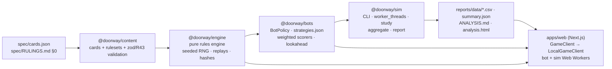

# Doorway — playtest app

The digital playtest kit for **Doorway**, a board game by CIAO: one life along a 40-year path, a tower of memory
discs, and a small Doorway at the end that lets you carry only one unbroken stretch through.

This repository holds:

- a **rules engine** that plays the v0.2 rulebook exactly (with every gap settled in `spec/RULINGS.md`),
- **11 bot strategies** plus noisy "human-like" variants,
- a **simulator** and the full **balance study** with its report (`reports/ANALYSIS.md`, `reports/analysis.html`),
- a **playable table** in the browser (hot-seat, solo, bots in any seat, replay, export/import),
- local **designer tools** (analysis dashboard, ruleset sandbox with in-browser sims, card browser).

Everything runs locally. Online rooms, surveys, telemetry and deployment come later (see [Later](#later)).

## Architecture



- `packages/engine` — no DOM, no Node APIs, no runtime dependencies. `init / currentPlayer / legalMoves / apply / isOver / score / cost`, plus `serialize / deserialize / replay / stateHash`. State is plain JSON; every move is a serializable action.
- `packages/content` — loads `spec/cards.json` directly (no copy) and `rulesets/v0.2-default.json` (byte-identical to RULINGS §0, tested).
- `packages/bots` — one `BotPolicy` interface; strategies are configured in `packages/bots/strategies.json`.
- `packages/sim` — `pnpm sim`, the study, aggregation and the report generator (TypeScript only).
- `apps/web` — Next.js App Router + Tailwind 4; tokens from `design/DESIGN.md`. The table only talks to a `GameClient`, so a networked client can replace the local one later.

## Run it locally

Requires Node 22 and pnpm 10.

```bash
pnpm install
```

```bash
pnpm --filter @doorway/web dev
```

Open http://localhost:3000. Other commands:

| Command | What it does |
|---|---|
| `pnpm test` | rule-coverage check + all unit and property tests (Vitest, fast-check) |
| `pnpm e2e` | Playwright: full 2p game vs a bot, keyboard, 360 px smoke, axe on every page |
| `pnpm lint` / `pnpm typecheck` / `pnpm build` | ESLint + Prettier, `tsc`, Next.js production build |
| `pnpm sim --players 4 --games 1000 --bots greedy,tempo,specialist,generalist` | a simulation run with a printed summary |
| `pnpm sim:study` | reruns the full study (S1–S5, ~438k games), then aggregates |
| `pnpm sim:aggregate` | folds `reports/runs/` into `reports/data/` |
| `pnpm sim:report` | regenerates `reports/ANALYSIS.md` and `reports/analysis.html` from `reports/data/` |
| `pnpm verify` | lint, typecheck, test, a quick sim, build |

`pnpm sim --help` lists every flag: `--players`, `--bots`, `--games`, `--seats rotate|fixed|all-permutations|field`,
`--seed`, `--ruleset <id|file.json>`, `--set key=value`, `--sweep 'key=a;b;c'`, `--workers`, `--shard i/n`, `--resume`,
`--logs N`, `--param lookahead.determinizations=4`, `--out`.

Pages: `/` new game · `/play` table · `/replay?id=…&move=N` · `/rules` · `/designer` analysis · `/designer/sandbox` ·
`/designer/cards` · `/design-check` (every component in every state).

Keyboard at the table: arrows move between cards, Enter selects / takes, R rushes (R again confirms), U undoes, Esc clears.

## How to change the rules

1. **Numbers:** copy `packages/content/rulesets/v0.2-default.json` to a new file with a new `id`, or try values first in
   `/designer/sandbox` (Save as new ruleset downloads the JSON and makes it selectable on the New game screen).
   Every key can also be overridden from the CLI by dotted path: `pnpm sim --set doorway.4=10,7,5,3`.
   Do **not** edit the default file — it must stay equal to RULINGS §0.
2. **Cards:** edit `spec/cards.json` (the single source of truth; the app imports it directly). `/designer/cards` checks a
   working copy and exports JSON/CSV.
3. **Rules text:** if a rule itself changes, update `spec/RULINGS.md` and add the rule to
   `packages/engine/test/RULE_COVERAGE.md` with an ID — `pnpm test` fails until a test names that ID.
4. Run `pnpm test`, then `pnpm sim:study` (or a quicker `pnpm sim --ruleset my-rules.json …`), then `pnpm sim:report`.

## How to add a bot strategy

Add about ten lines to `packages/bots/strategies.json`:

```json
"cautious": {
  "label": "Cautious",
  "kind": "weighted",
  "params": { "avgYears": 3, "neverRush": 1 },
  "weights": { "ppy": 1.8, "points": 0.3, "cost": -0.4, "extraTurn": 1.0, "projDelta": 0.4, "rush": -2 }
}
```

The feature names are listed in `packages/bots/src/features.ts` (`FEATURES`): points per year, extra turns, experience
gained, Full life / Passion / Reflection progress in the projected kept window, Rush tempo and denial, age unlocks, etc.
A genuinely new idea needs one new feature function there. The strategy is then available everywhere: `pnpm sim --bots cautious`,
noisy variants (`cautious@eps0.1`), the study, and the New game screen. Add it to the expectations in
`packages/bots/test/bots.test.ts` (the list of ids) and the strength tests pick it up automatically.

## How to read the reports

- `reports/ANALYSIS.md` opens with plain-language answers (the Doorway question first), then sections 1–12: Doorway
  relevance, win rates with Wilson 95% intervals and the 2p matchup matrix, seat advantage (in points and relative, R45),
  score sources and predictors, game length and extra turns, Rush, cards, experience, powers, sweeps, suggested tweaks,
  and the "ready to print" table.
- `reports/analysis.html` is the same as a self-contained page (no network); `/designer` renders it inside the app.
- `reports/data/`: `games.csv.gz` and `players.csv.gz` (every game and player-game of the study, also as `.parquet`),
  `cards.csv` (per-card pick and win rates by study/value), `matchups.csv`, `sweeps.csv`, `summary.json` (everything the
  report and dashboard show) and `logs-sample.jsonl.gz` (1,000 full replays — open any of them in `/replay`).
- Study IDs: S1 2p round robin · S2 3p/4p all seatings · S3 noisy field · S4 sweeps (S4C = lookahead confirmation) · S5 solo.

## Repository map

```
spec/            rulebook, build spec, cards.json, RULINGS.md   (read-only)
design/          DESIGN.md + mockups                             (read-only)
packages/engine  rules engine + tests (RULE_COVERAGE.md, property tests, §16 worked example)
packages/content cards + rulesets + validation
packages/bots    strategies.json, features, policies, lookahead, runner
packages/sim     CLI, study, aggregate, report
apps/web         Next.js app (+ Playwright e2e in apps/web/e2e)
reports/         study data and analysis
STATUS.md        build status · DECISIONS.md  judgement calls and proposed rulings
```

## Later

Not built in this local version (BUILD_PROMPT §7), with the architecture kept ready for them:

- online rooms with nickname join and reconnect (`Lobby.dc.html`, `LobbyPhone.dc.html`), server-authoritative engine,
  online undo with `revealAt` (R32, R39);
- the tutorial, the post-game survey (R36), "Something feels off" (R37), telemetry and the private feedback dashboard
  (`Feedback.dc.html`), the privacy line (R40) and storage rules (R44);
- Postgres and deployment (Vercel + Neon).
